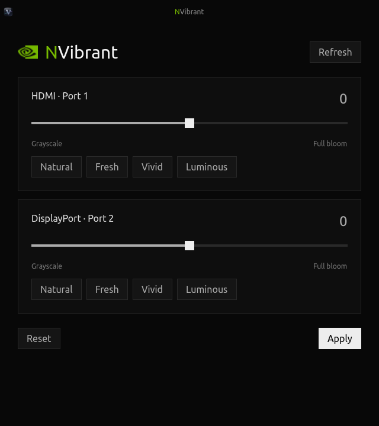

# NVibrant interface



NVibrant is a native Rust/GTK 4 app with a minimal black interface. The heading uses Ubuntu, with a system
sans-serif fallback. The “N” is green, with a small NVIDIA SVG to the left.
Panels, controls and slider thumbs have square corners.
The interface shows displays, sliders, presets, Refresh,
Reset and Apply. Routine saved-settings text, marketing copy,
the instruction line, manual GPU selector and old Details & compatibility panel
have been removed.

## Controls

- **Refresh** automatically discovers connected displays across all NVIDIA GPUs
  without changing colours. GPU device minors are read from the NVIDIA driver;
  there is no manual GPU control. Pending values survive refresh for the same GPU
  and physical connector.
- **Natural**, **Fresh**, **Vivid**, **Luminous** select 0, 256, 512 or 768.
- **Apply** applies the displayed values and saves only after success.
  The button briefly reads Applied when successful. Errors appear in a dialog.
- **Reset** selects zero on all displayed outputs; Apply commits it.

Opening the app detects NVIDIA screens and loads per-GPU/per-connector preferences, without
writing to hardware. A failed save is reported separately from a failed hardware
request. Driver operations run in bounded child processes off the GTK thread;
closing waits for active work to finish. Each child has a 15-second timeout.

## Preferences and restart restoration

`~/.config/nvibrant/settings.json` is compatible with the previous Python app.
An absolute `XDG_CONFIG_HOME` overrides the config root. Sliders alone do not
save, and demo mode neither loads nor writes real preferences. Concurrent saves
merge each GPU's outputs under a lock and atomically replace the JSON file.

The installer creates `io.github.nvibrant.Aero.Restore.desktop` under the user's
XDG autostart directory. After desktop login it runs `nvibrant-gtk --restore`
without opening a window. It retries discovery/driver errors up to 12 times,
five seconds apart, applies only connected saved connectors and never rewrites
preferences. Disable it in Startup Applications if desired. Uninstall removes
the managed entry; upgrades preserve disabled entries.

A compositor without XDG autostart support needs `nvibrant-gtk --restore` in its
own startup configuration. For sleep or an in-session driver reset, Apply again
or run that command manually. Remove competing older vibrance startup commands.

## Compatibility

NVIDIA must drive the output directly; an integrated-GPU laptop panel cannot be
controlled through this backend. Rebuild against matching headers after NVIDIA
driver changes if discovery reports an ioctl failure. Hardware discovery is
read-only and partial enumeration fails instead of exposing incomplete controls.
Restore and Apply match physical connectors and leave other outputs untouched.

## Preview and checks

```bash
make
./run-gtk --demo
make test
make test-gui
```

The Rust GTK smoke test covers discovery, pending slider preservation, Apply,
Reset, automatic display detection and preview isolation. See [BUILDING.md](BUILDING.md) for
build dependencies and installation details.
