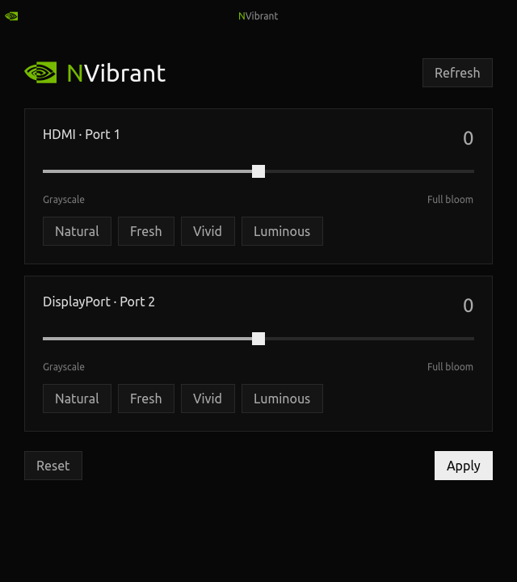

# NVibrant

Tool for Wayland to change vibrancy on NVIDIA GPUs.



## Install

```sh
curl -fsSL https://raw.githubusercontent.com/Nirusaki-Malaal/nvibrant/main/install.sh | sh
```

Supports Linux x86-64 and ARM64. The installer handles dependencies and builds
for your NVIDIA driver. Run it as your normal user; it may ask for sudo to
install system packages.

Open **NVibrant** from your app menu, or run `~/.local/bin/nvibrant-gtk`.

## Use

1. Choose a preset or move a screen's slider.
2. Click **Apply** to save and apply your colours.
3. Click **Reset**, then Apply, to return to natural colours.

Screens are detected automatically. Your settings are remembered and restored
after you log in following a reboot.

Your screen must be driven by NVIDIA. Laptop screens connected to an integrated
GPU cannot be adjusted with this tool. GTK 4.8 or newer is required.

## Update

Run the install command again. Your settings are kept.

## Uninstall

```sh
~/.local/bin/nvibrant --uninstall "$HOME/.local"
```

Your saved settings are kept for a later reinstall.

[More help](docs/USAGE.md) · [Build from source](docs/BUILDING.md)

## License

[GNU GPL v3](LICENSE). Third-party notices: [NOTICE.md](NOTICE.md).
