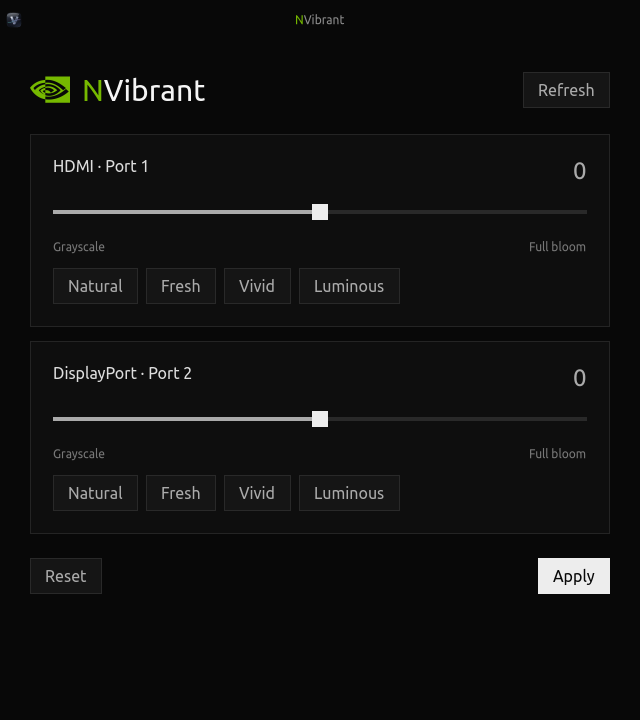

# NVibrant

Tool for Wayland to change vibrancy on NVIDIA GPUs.

A native **Rust + GTK 4** app for NVIDIA digital vibrance on Linux. An Ubuntu wordmark,
a minimal black interface with square corners, automatic NVIDIA display detection, per-display sliders
and four presets. The title pairs a green “N” with a small NVIDIA SVG.
The entire application, NVIDIA backend, settings store, login restore and installer are Rust.
There is no Python or C++ application runtime.



## Install

Build and install natively on **x86-64 or ARM64 Linux**:

```bash
curl -fsSL https://raw.githubusercontent.com/Nirusaki-Malaal/nvibrant/main/build.sh | bash -s -- install --install-deps
```

The installer selects headers matching your running NVIDIA driver, compiles the
Rust executable, and installs into `~/.local`. `--install-deps` explicitly opts
into installing distro packages and may use sudo. Omit it if dependencies are
already available. GTK 4.8 or newer is required; an NVIDIA driver must drive your
display directly for hardware controls.

You need Rust/Cargo >=1.85, Clang/libclang, a C linker,
`pkg-config`, GTK 4 development headers, Git and Bash. If your distro's Rust is
older than the locked dependencies require, update the toolchain before building.
Ubuntu is the preferred font, with Cantarell/sans-serif fallbacks.

From a checkout:

```bash
git clone https://github.com/Nirusaki-Malaal/nvibrant.git
cd nvibrant
make deps       # Optional: install distro build dependencies
make check
make
make install
~/.local/bin/nvibrant-gtk
```

Both Make and the curl installer use `build.sh`. The installed executable embeds
its theme and icon and runs independently of the checkout. Rust is only needed
to build; GTK and its shared-library dependencies are needed at runtime.

## Use

1. Choose a preset or move a display's slider.
2. Click **Apply** to apply and save the selected values.
3. **Reset** selects zero; click Apply to save the reset.
4. **Refresh** rescans connected displays across all NVIDIA GPUs automatically.

The heading is simply **NVibrant**. The GPU selector has been removed; connected
NVIDIA screens are detected automatically. There is no marketing subtitle, instruction
line, saved-colours status panel, or Details & compatibility section. Errors appear
in a dialog when needed; Apply briefly confirms success on the button itself.
Opening and refreshing the window only discover displays and load preferences.

Values range from −1024 (grayscale) through 0 (natural) to 1023 (maximum).
Successfully applied preferences are saved per GPU and physical output connector
in `~/.config/nvibrant/settings.json`, or under an absolute `XDG_CONFIG_HOME`.
**Existing settings from the Python version are read automatically.** Failed
hardware calls, unapplied edits and demo previews do not overwrite preferences.

Saved colours restore automatically in the background at **desktop login after
a reboot**, without opening a window. Discovery and driver errors are retried up
to 12 times, five seconds apart. Only connected outputs with saved values change.
Disable the `NVibrant saved colours` entry in Startup Applications to opt out;
upgrades preserve disabled entries. After sleep or an in-session driver reset,
use Apply or run `nvibrant-gtk --restore`. A compositor that does not run XDG
autostart entries needs that command added to its own startup configuration.

## CLI

```bash
nvibrant                       # Open the GUI
nvibrant-gtk --demo             # Preview without hardware or saved settings
nvibrant --list-all-json        # Auto-detect connected screens across NVIDIA GPUs
nvibrant --list-json            # Read-only output discovery for one GPU
nvibrant --gpu 0 --list-json
nvibrant 512 512                # Positional values, including disconnected ports
nvibrant --skip 512             # Leave the first output untouched
nvibrant-gtk --restore          # Restore saved GUI preferences without a window
ATTRIBUTE=dithering nvibrant 2  # Original attribute controls remain available
nvibrant --version
```

Numeric CLI commands apply directly and do not update GUI preferences. Missing
positional values retain the original CLI default of natural vibrance; use
`--skip` for outputs you want to leave untouched. Unknown flags are errors.
`NVIDIA_GPU` selects the default GPU; explicit `--gpu` takes precedence.

## Build and verify

```bash
make test        # Rust settings, restore, CLI and installer tests
make test-gui    # Real GTK controls with simulated hardware under Xvfb
cargo fmt --check
cargo clippy --all-targets -- -D warnings
make install PREFIX="$HOME/.local"
make uninstall
```

Custom builds: `make DRIVER_VERSION=615.78.08 JOBS=2`, or supply an absolute
`NVIBRANT_NVIDIA_HEADERS` directory. Rebuild after a driver upgrade if ioctl calls
fail. No system Python packages or NVIDIA kernel drivers are installed by the
normal build. Uninstall removes the app and its managed desktop/login entries,
while retaining saved preferences.

See [BUILDING.md](BUILDING.md) for architecture, installation layout and build
options, and [GUI.md](GUI.md) for controls and compatibility.

## Credits and license

Based on [Tremeschin/nvibrant](https://github.com/Tremeschin/nvibrant), rewritten
in Rust for this fork. NVIDIA ABI bindings are generated at build time from the
[Open GPU Kernel Modules](https://github.com/NVIDIA/open-gpu-kernel-modules) headers.
The title uses a hand-coded NVIDIA-style eye SVG.
NVIDIA is a trademark of NVIDIA Corporation. MIT license for the application; see [license.txt](license.txt).
