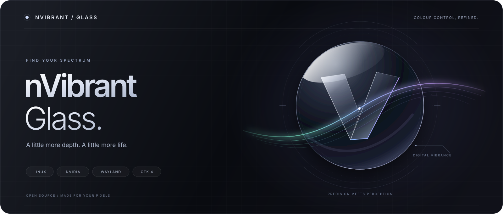
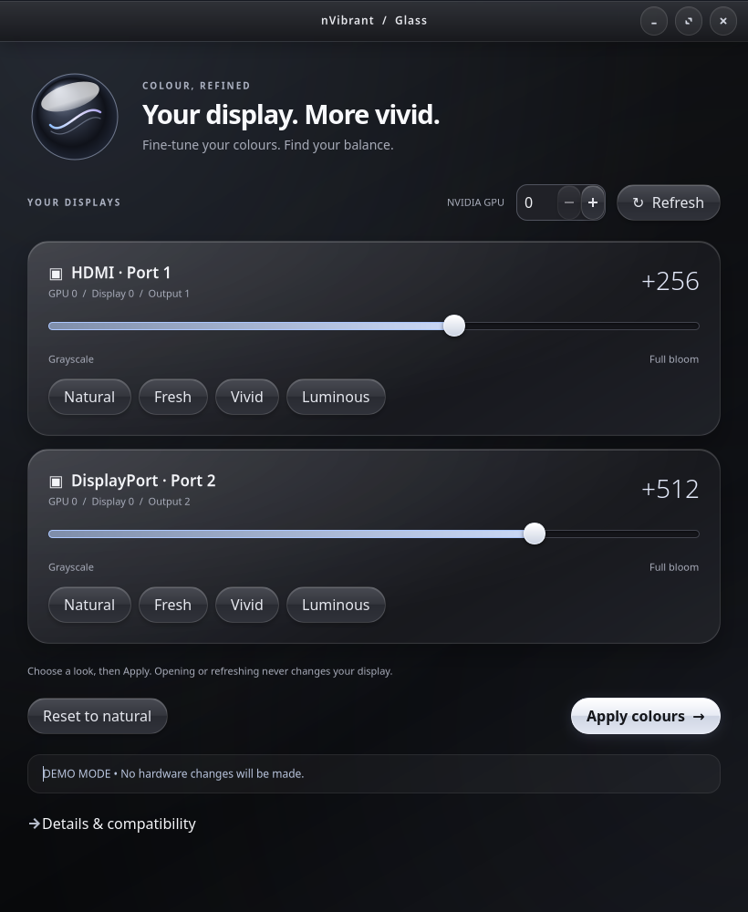

# nVibrant Glass



A native GTK 4 control panel for NVIDIA digital vibrance on Linux, with glossy
black glass panels, per-display sliders, presets, and explicit Apply/Reset.



## Install with curl

The same script builds **natively on x86-64 and ARM64 Linux**. It checks your
architecture, selects headers for the running NVIDIA driver (or the pinned tag
when building without a GPU), compiles locally, and installs into `~/.local`.

```bash
curl -fsSL https://raw.githubusercontent.com/Nirusaki-Malaal/nvibrant/main/build.sh | bash -s -- install --install-deps
```

`--install-deps` opts into installing system packages and may invoke `sudo`.
Omit it if dependencies are already installed. Dependency installation supports
Debian/Ubuntu, Arch, Fedora, and openSUSE; on other Linux distributions, install
the dependencies manually and run the script without that flag.

Launch from the app menu or run:

```bash
~/.local/bin/nvibrant-gtk
```

You can also save and inspect the script before running it:

```bash
curl -fsSL https://raw.githubusercontent.com/Nirusaki-Malaal/nvibrant/main/build.sh -o nvibrant-build.sh
bash nvibrant-build.sh install --install-deps
```

Choose a custom prefix or a driver header version:

```bash
bash nvibrant-build.sh install --prefix "$HOME/.local" --driver-version 615.78.08
```

ARM64 support means native Linux builds for ARM64 systems with a compatible
NVIDIA driver controlling the display. This does not add support for macOS,
Apple GPUs, integrated Intel/AMD displays, or every Jetson driver stack.

## Build with Make

```bash
git clone --branch main https://github.com/Nirusaki-Malaal/nvibrant.git
cd nvibrant
make deps           # optional: install distro build and GTK dependencies
make                # native Meson/Ninja build
make install        # GUI, native CLI and desktop launcher in ~/.local
```

The build script fetches the required NVIDIA headers automatically; cloning all
submodules is unnecessary. Re-running install upgrades this installation.

| Command | Purpose |
| --- | --- |
| `make check` | Check compiler, Meson, Ninja and Python/GTK dependencies |
| `make` | Build the native backend |
| `make install PREFIX=/absolute/path` | Install to a custom prefix |
| `make uninstall PREFIX=/absolute/path` | Remove that installation |
| `make test` | Run backend and installer regression tests |
| `make test-gui` | Run GTK smoke checks under Xvfb |
| `make clean` | Clean compiled output |

Variables: `PREFIX`, `BUILD_DIR` (absolute), `DRIVER_VERSION`, `JOBS`, `PYTHON`.
The Makefile delegates to `build.sh`; direct usage works too:

```bash
./build.sh build --jobs 4
./build.sh install
./build.sh uninstall
./build.sh --help
```

To preview the GUI without accessing NVIDIA hardware:

```bash
./run-gtk --demo
# Or, after installation:
~/.local/bin/nvibrant-gtk --demo
```

**[Detailed usage and compatibility → GUI.md](GUI.md)** ·
**[Build/install details → BUILDING.md](BUILDING.md)**

This is a GUI fork of [Tremeschin/nvibrant](https://github.com/Tremeschin/nvibrant).
The original NVIDIA ioctl backend and CLI remain available; the upstream PyPI
package is separate from this fork's GTK installer.

## 🔥 Description

NVIDIA GPUs have a nice feature called *Digital Vibrance* that increases the colors saturation of the display. The option is readily available on [nvidia-settings](https://github.com/NVIDIA/nvidia-settings/), but is too coupled with libxnvctrl, making it softly "exclusive" to the X11 display server over wayland; but I paid for my pixels to glow :^)

An interesting observation is that the setting persists after modifying it on X11 and then switching to Wayland. I theorized [(1)](https://github.com/libvibrant/vibrantLinux/issues/27#issuecomment-2729822152) [(2)](https://www.reddit.com/r/archlinux/comments/1gx1hir/comment/mhpe2pk/?context=3) it was possible to call some shared library or interface to configure it directly in their driver, independently of the display server, and indeed, it is possible!

This project uses `nvidia-modeset` and `nvkms` headers found at [nvidia/open-gpu-kernel-modules](https://github.com/NVIDIA/open-gpu-kernel-modules/) to make [ioctl](https://en.wikipedia.org/wiki/Ioctl) calls in the `/dev/nvidia-modeset` device for configuring display attributes.

**Note**: A future intended way will be through [NVML](https://developer.nvidia.com/management-library-nvml), as evident by some [nvidia-settings](https://github.com/NVIDIA/nvidia-settings/blob/6c755d9304bf4761f2b131f0687f0ebd1fcf7cd4/src/libXNVCtrlAttributes/NvCtrlAttributesNvml.c#L1235) comments

<sup><b>❤️ Consider</b> [supporting](https://github.com/sponsors/Tremeschin/) my work, this took 30 hours to figure out, implement, write a website, make it convenient 🫠</sup>

## 📦 Getting Started

<div align="center">
  <a href="https://nvibrant.tremeschin.com/">
    
  </a>
  <i>
    Visit the documentation at
    <a href="https://nvibrant.tremeschin.com/">https://nvibrant.tremeschin.com/</a>
  </i>
</div>
